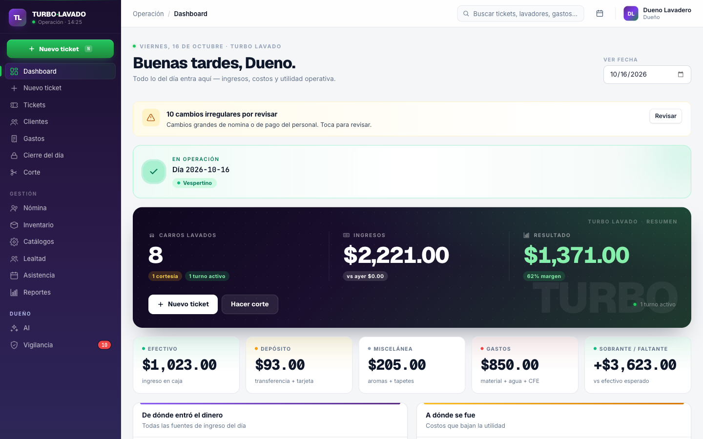
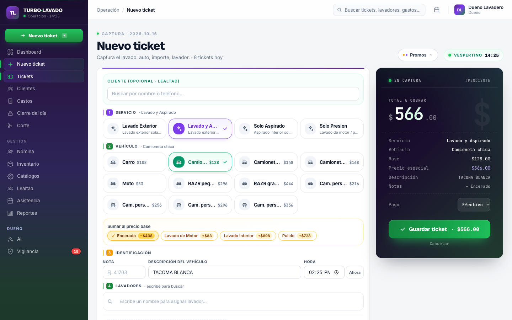
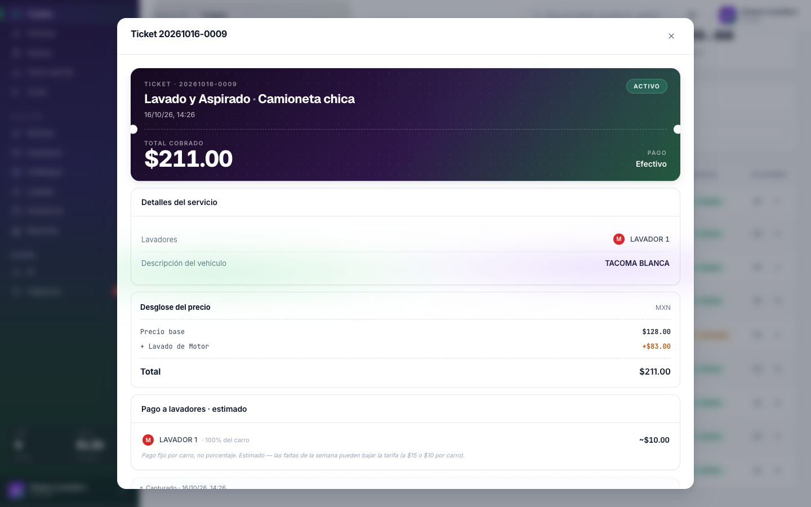
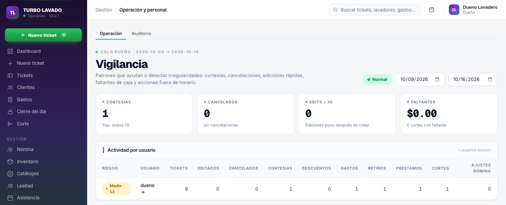

# Turbo Lavado

**Operations platform for a real car wash: tickets, cash, payroll, inventory, reports and an owner-only AI analyst.** Built solo by Brandon Rubio for his family's car wash in Reynosa, Mexico, replacing a paper + Excel workflow.

[](https://github.com/brubiol/lavadero-platform/actions/workflows/deploy.yml)


**Status:** v1 feature-complete, designed with the owner against the business's real 2025–2026 records, and preparing for go-live at the store. Hosting costs $0/month.

> **¿Eres dueño, gerente u operador?** La guía de uso en español está en **[docs/GUIA-DE-USO.md](docs/GUIA-DE-USO.md)**.

---

| | |
|---|---|
|  |  |
| **Dashboard:** today's cars, revenue, open shift and recent tickets at a glance. | **New ticket:** server-resolved pricing by service and vehicle size, add-ons, courtesy and prepaid-package redemption. |
|  |  |
| **Ticket detail:** full price math (base, add-ons, total) and each washer's estimated per-car pay. | **Vigilancia (owner only):** anti-theft patterns per user, covering courtesies, voids, quick edits after capture, cash shortages and after-hours actions. |

---

## What it does

| Role | Day-to-day |
|---|---|
| **Operador** (cashier) | Opens shifts, rings up tickets with automatic pricing, logs expenses and withdrawals, counts the drawer at shift close (*corte*), records attendance. |
| **Gerente** (manager) | Everything above, plus weekly payroll, inventory, price catalogs, the loyalty program and reports with Excel export. |
| **Dueño** (owner) | Everything above, plus the AI analyst, the *Vigilancia* anti-theft dashboard and the full audit trail. |

The roles are hierarchical (`OPERADOR < GERENTE < DUENO < ADMIN`) and enforced on the server with `@PreAuthorize`. The UI only hides what the API already refuses.

---

## Engineering highlights

Each point links to the code that backs it.

- **Money is modeled as ledgers, not balances.**
  - Advances, debt and stock movements are append-only. Corrections are new rows, never `UPDATE`s, and balances are derived at query time.
  - A product has no `current_stock` column.
  - See [`DebtLedgerService`](api/src/main/java/com/lavadero/api/payroll/service/DebtLedgerService.java) and [`inventory/`](api/src/main/java/com/lavadero/api/inventory/).
- **Prices are server-resolved and snapshotted.**
  - Effective-dated `service_prices` decide the price, and the client never sends one.
  - Add-ons are structured line items, so a ticket can always explain its total, even after catalog prices change.
  - See [`TicketService`](api/src/main/java/com/lavadero/api/operations/service/TicketService.java).
- **Shift cash variance always has an explanation.**
  - Expected cash = cash sales + prepaid + inventory sales + debt repayments − expenses − withdrawals − advances.
  - A shift that closes short cannot be saved without a written reason, and the close is audited.
  - See [`ShiftCloseService`](api/src/main/java/com/lavadero/api/cash/service/ShiftCloseService.java).
- **The AI is advisory and enforced by its dependencies, not its prompt.**
  - [`AiInsightService`](api/src/main/java/com/lavadero/api/ai/service/AiInsightService.java) is constructed only with read-only report, cash, payroll and inventory services. No code path lets it write a ticket, expense or payroll row.
  - A deterministic local provider keeps tests and CI independent of any LLM.
- **Tests run against real Postgres.**
  - 192 integration tests across 30 classes use Testcontainers. There's no H2 and no mocked repositories.
  - [`ExcelOperationFlowsIntegrationTest`](api/src/test/java/com/lavadero/api/ExcelOperationFlowsIntegrationTest.java) drives a full business day through the REST API, then opens the exported `.xlsx` and checks every total against the live report.
- **Migrations are forward-only.**
  - There are 62 Flyway versions, and an applied migration is never edited. Reference data lives in migrations, not in startup code.
  - Two years of historical daily numbers were seeded so reports cross the cutover seamlessly.

---

## Architecture

```
                      ┌──────────── one VM ($0, Oracle Cloud Always Free ARM) ────────────┐
                      │                                                                    │
 browser ──HTTPS──►   │  Caddy ──► web (Nginx + React SPA) ──/api──► api (Spring Boot) ──► PostgreSQL 16
 (per-business        │  (TLS,                                         JWT, RBAC,          Flyway
  domain)             │   routing)                                     ledgers, AI         per business
                      └────────────────────────────────────────────────────────────────────┘
```

- **Backend:** a package-by-feature Spring Boot monolith with 18 bounded contexts (`operations`, `cash`, `payroll`, `inventory`, `money`, `reports`, `ai`, `oversight`, …).
  - DTOs are Java records and controllers never return entities.
  - `@Transactional` is used only on services.
  - Money is `BigDecimal` with an explicit currency column.
  - Timestamps are UTC `Instant`s, converted to `America/Monterrey` only at the UI.
- **Auth:** Spring Security 6 as an OAuth2 resource server, with HMAC-SHA256 JWTs and rotating opaque refresh tokens.
- **Frontend:**
  - React 19, TypeScript and Vite.
  - TanStack Query for server state, React Hook Form + Zod for forms.
  - A bespoke design system on raw Tailwind, with no component library.
- **Multiple businesses:**
  - Each business runs its own isolated copy (its own database and domain) behind one shared Caddy on the same free VM.
  - Every table already carries `tenant_id`, so shared-database multi-tenancy is a refactor rather than a rewrite.

---

## Engineering decisions

Six real problems and how each was solved.

**1. "The drawer is short and nobody knows why."**
Every cash event (tickets, expenses, withdrawals, advances, debt repayments) became a ledger row feeding one expected-cash formula. A short *corte* can't close without a typed reason, and Vigilancia rolls shortages up per operator over time. See [`ShiftCloseService`](api/src/main/java/com/lavadero/api/cash/service/ShiftCloseService.java).

**2. "The AI must never touch the money."**
Instructing the prompt not to write data isn't enforcement, so the dependency graph enforces it. The AI service can only receive read-only services, and breaking that would take a visible new constructor dependency in a one-line diff. See [`AiInsightService`](api/src/main/java/com/lavadero/api/ai/service/AiInsightService.java).

**3. "Washers want to repay advances in cash, mid-week."**
Migration V40 adds `debt_payments`, the cash side, alongside a `PAYMENT` ledger entry, the accounting side. The corte formula was updated in the same commit, so a repayment raises expected cash and lowers the washer's debt atomically. Integration tests cover both sides.

**4. "Don't lose the history."**
`historical_daily_snapshots` (V10–V11) holds 493 days of the owner's 2025–2026 spreadsheet numbers, and the reports service merges them with live data. From day one the owner can compare this Tuesday to every previous Tuesday.

**5. "Where did this price come from, and what did the washer earn?"**
Add-ons used to be folded into an opaque price override. They are now server-priced `ticket_extras` (V61), so the ticket view reconstructs base → add-ons → total. It also shows each washer's estimated pay, which is a flat amount per car split by share, not a percentage of the sale. That model was verified against `PayrollService`, not assumed. See [`TicketDtos`](api/src/main/java/com/lavadero/api/operations/web/TicketDtos.java).

**6. "Prepaid packages without abuse."**
Customers can keep a car on file and buy a block of prepaid washes (V62). A package is locked to a vehicle size: a bigger car than the package covers triggers a warning and charges the difference. See [`CustomerPackageService`](api/src/main/java/com/lavadero/api/customers/service/CustomerPackageService.java).

---

## Tech stack

| Layer | Choice | Notes |
|---|---|---|
| Language | Java 21 | Records for DTOs; no Lombok, no MapStruct |
| Framework | Spring Boot 3.4, Spring Web MVC | Package-by-feature monolith |
| Security | Spring Security 6 + OAuth2 Resource Server | HMAC-SHA256 JWT, refresh rotation, `@PreAuthorize` |
| Persistence | Spring Data JPA + PostgreSQL 16 | Append-only ledgers, no denormalized totals |
| Migrations | Flyway | 62 versions, forward-only |
| Validation | Jakarta Bean Validation | On every request DTO |
| API docs | Springdoc OpenAPI | `/swagger-ui.html` |
| Excel | Apache POI 5.3 | Multi-sheet exports, round-trip tested |
| Tests | JUnit 5, Testcontainers, Playwright | Real Postgres; isolated e2e stack |
| AI | OpenAI-compatible provider + deterministic fallback | Advisory only (`ai_insights`) |
| Frontend | React 19, TypeScript, Vite, Tailwind | TanStack Query v5, React Hook Form + Zod |
| Infra | Docker multi-arch images, Caddy | Oracle Cloud Always Free ARM VM, $0/month |
| CI/CD | GitHub Actions → GHCR → SSH deploy | Tests and e2e gate every deploy; health-checked rollout |

### By the numbers

- About 5 weeks of solo development (May–June 2026), iterated with the owner.
- About 15.9k lines of Java and 15.3k lines of TypeScript.
- 18 backend bounded contexts and 16 frontend routes.
- 62 Flyway versions (V1–V62; the gaps in numbering are intentional).
- 192 backend integration tests and 9 Playwright end-to-end specs.

---

## Run it locally

You need Docker and Java 21 (Maven comes through the wrapper). Node 20+ is only needed for frontend development.

```bash
# Everything in Docker: postgres + api + web
docker compose up --build -d
open http://localhost:5173            # login: LAVADERO_BOOTSTRAP_* defaults in docker-compose.yml

# Or iterate on the host
docker compose up postgres -d
cd api && ./mvnw spring-boot:run      # API on :8080, Swagger at /swagger-ui.html
cd web && npm install && npm run dev  # web on :5173
```

Tests:

```bash
./mvnw -f api/pom.xml verify          # 192 integration tests on Testcontainers
./scripts/e2e.sh                      # Playwright against an isolated stack (ports 5433/8090)
```

## Deploying

Production runs for $0/month on one Oracle Cloud Always Free VM. Pushing to `main` runs the tests, builds multi-arch images and deploys over SSH, with a health check gating the rollout. Adding a second business takes two commands on the VM. The full runbook is in **[docs/DEPLOY.md](docs/DEPLOY.md)**.

---

## Project structure

```
lavadero-api/
├── api/                                  Spring Boot backend
│   ├── src/main/java/com/lavadero/api/
│   │   ├── ai/                           Daily brief, watchdog, analyst chat, investigations
│   │   ├── attendance/                   Attendance and absence codes
│   │   ├── audit/                        Audit events and flagged-event drill-down
│   │   ├── auth/                         Login, refresh rotation, bootstrap users
│   │   ├── cash/                         Cash counts and shift close (corte)
│   │   ├── catalog/                      Employees, services, vehicle sizes, prices
│   │   ├── corrections/                  Supervised post-shift corrections
│   │   ├── customers/                    CRM, loyalty, car-on-file, prepaid packages
│   │   ├── inventory/                    Products and append-only movements
│   │   ├── money/                        Expenses, withdrawals, advances, debt repayments
│   │   ├── operations/                   Business days, shifts, tickets, add-ons
│   │   ├── oversight/                    Vigilancia anti-theft patterns
│   │   ├── payroll/                      Periods, entries, debt ledger
│   │   ├── reports/                      Daily, monthly, historical, Excel export
│   │   └── security/                     SecurityConfig, JWT filter
│   └── src/main/resources/db/migration/  Flyway V1–V62
├── web/                                  React 19 + TypeScript frontend
│   ├── src/App.tsx                       Routes and screens
│   ├── src/components/                   Design-system primitives, layout, icons
│   └── tests/e2e/                        Playwright specs
├── docs/                                 Deploy runbook, operator guide, backups
├── scripts/                              VM setup, deploy, backups, e2e runner, seeds
├── docker-compose.yml                    Local dev
├── docker-compose.prod.yml               Production: one copy per business
├── docker-compose.edge.yml               Production: shared HTTPS edge (Caddy)
└── .github/workflows/deploy.yml          Test → build → deploy
```

---

## Contact

**Brandon Rubio** · [brandonrubio50@gmail.com](mailto:brandonrubio50@gmail.com) · [github.com/brubiol](https://github.com/brubiol)

Open to backend Java / Spring Boot software engineering roles.
